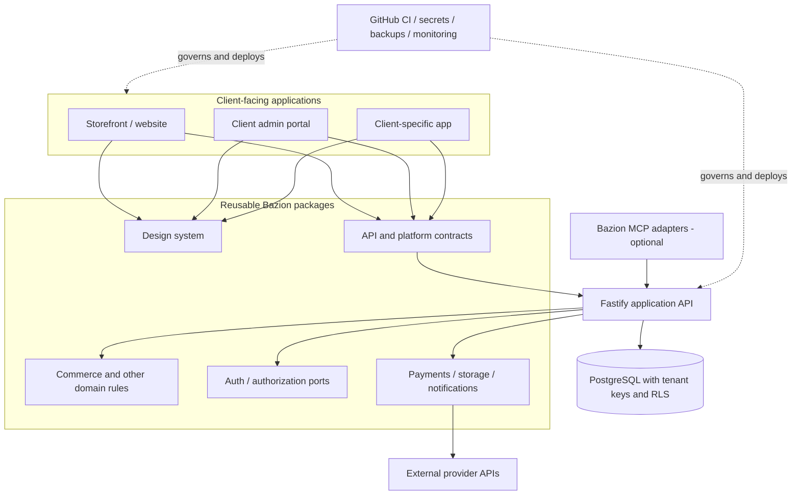
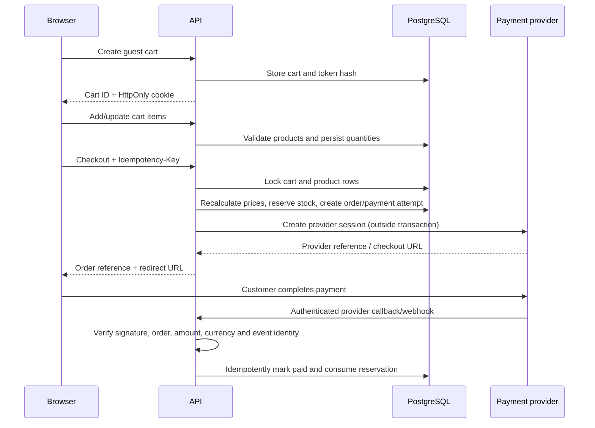

# Bazion Web Platform Architecture

## Architectural goal

Build common capabilities once and reuse them across independent client solutions. Share source code and contracts, not client data, secrets, or deployment state.

## Recommended shape: modular monorepo + modular monolith

```text
Client projects / storefronts / admin portals
                 |
          Shared packages
  UI | contracts | domain | integrations
                 |
          Application APIs
      Fastify modular API (v1)
                 |
       PostgreSQL + provider APIs
                 |
     Operations: CI, secrets, backups,
      monitoring, domains, deployments
```

### Why not microservices immediately?

A modular monolith keeps transactions, local development, deployment and debugging simpler while Bazion validates the business modules. Modules have explicit boundaries and can be extracted later if independent scaling, team ownership, or deployment needs justify it. Do not split a service just because it is a folder.

## Repository map

- `apps/api`: server-side HTTP API and application orchestration.
- `apps/storefront`: customer-facing Next.js example.
- `apps/admin`: reserved for the shared client administration app.
- `packages/platform-contracts`: cross-cutting tenant/principal types.
- `packages/api-contracts`: Zod schemas shared by clients and server.
- `packages/commerce-domain`: pure cart/order rules; no database or HTTP dependencies.
- `packages/database`: Drizzle schema, SQL migrations, seed and database helpers.
- `packages/payments`: payment-provider port and normalized result types.
- `packages/auth`: authentication/authorization ports; connect a proven identity provider rather than inventing password/session cryptography.
- `packages/ui`: shared design-system components.
- `packages/notifications`: email/SMS/push ports.
- `packages/storage`: object-storage port for uploads and documents.
- `packages/booking`: future booking-domain module.
- `packages/analytics`: privacy-aware event contract.
- `mcp`: MCP server design. MCP adapters call the same API/domain capabilities; MCP is not the website's cart implementation.
- `templates`: per-client configuration examples, not copies of business logic.

## Dependency direction

Allowed: apps -> packages -> domain contracts.
Avoid: domain packages importing apps, database packages importing storefronts, or one client app importing another client's data/configuration.

`commerce-domain` must remain framework- and provider-independent. HTTP handlers validate/authorize requests, call the application/service layer, and map domain errors to HTTP responses. Database repositories enforce tenant scoping and persistence constraints.

## Client isolation

- Every business-owned row includes `tenant_id`.
- Every query includes tenant scope even when PostgreSQL RLS is enabled.
- Composite tenant-aware foreign keys prevent accidental cross-tenant references.
- RLS is defense in depth, not a substitute for authentication or explicit tenant filters.
- Resolve tenant context from a trusted source. Never trust a tenant ID supplied in an arbitrary body or query string.
- Never share payment credentials, storage buckets, API keys or personal data between clients.
- Use separate production environments/secrets per client where isolation or contractual requirements justify it. A shared database with RLS is not a blanket guarantee of compliance.

## Deployment topology

Start with one API deployment and one Postgres database for the Bazion demo environment. For actual client work, choose per-client database/schema/deployment boundaries according to risk, scale and budget. Static sites can deploy independently to Cloudflare Pages or another host. Do not force all clients into one deployment.

## Extension points

- Add features through small packages and explicit ports.
- Add adapters for providers (payments, mail, storage) without leaking vendor SDK types into domain logic.
- Version reusable packages with semver. Publish packages only when there is a real cross-repository need; workspace dependencies are simplest initially.
- Add MCP server tools only for controlled, authenticated business actions. Reuse APIs and domain functions; never expose privileged database access directly to an agent.

## Logical component diagram



## Checkout sequence



The running starter currently implements the cart/order path and a development-only mock payment. The real provider callback, webhook signature verification, reconciliation and reservation expiry steps are production milestones, not yet complete.
