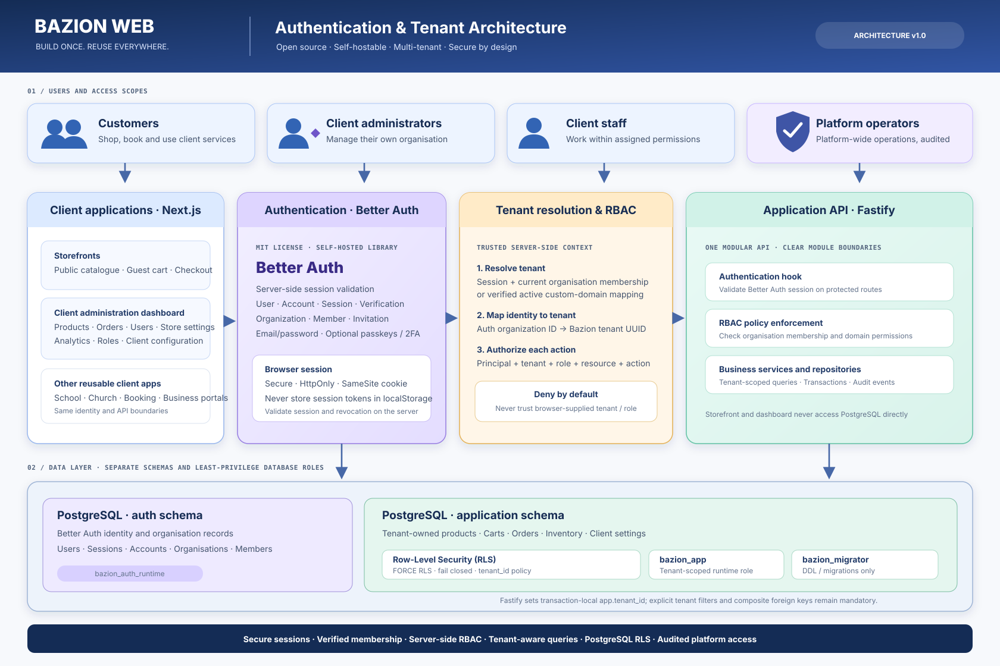

# Authentication and tenant isolation

> **Status:** Architecture decision and diagram only. This document defines the target design for the next implementation stage; it does not claim that Better Auth, the tenant resolver, or the admin dashboard is already wired into the running application.

## Goals

- Use software that is free to use, open source, self-hostable, and actively maintained.
- Keep identity and organization membership in the application we own; do not require a paid hosted identity provider.
- Let one user belong to multiple client organizations while keeping client data isolated.
- Authorize every business operation on the server.
- Enforce tenant isolation twice: in application queries and in PostgreSQL Row-Level Security (RLS).
- Keep the authentication provider out of the commerce domain packages so it can be replaced without rewriting business rules.

## Selected starting stack

| Concern | Choice | Why |
|---|---|---|
| Authentication | Better Auth | TypeScript-native, MIT-licensed, self-hosted library; email/password, sessions and extensible plugins |
| Organization and membership | Better Auth Organization plugin | Organization, member, invitation and organization-scoped role model |
| Authorization | Better Auth access-control definitions plus Bazion server-side policy layer | Reusable permissions with server-side enforcement on every API operation |
| API integration | Existing Fastify API | Official Better Auth Fastify integration; keep one API deployment initially |
| Persistence | Existing PostgreSQL + Drizzle | Official Better Auth Drizzle adapter; use a dedicated PostgreSQL `auth` schema |
| Application data | Existing PostgreSQL application schema | Tenant UUID on business-owned rows with RLS and tenant-aware foreign keys |
| Dashboard | Existing Next.js application family | Client admin UI calls the authenticated Fastify API; it never talks directly to PostgreSQL |

### Version and maintenance policy

Research checked on **5 November 2026** found Better Auth **1.7.17** as the current stable npm release. The package is MIT licensed. Better Auth's v1.7.16 release included a security update addressing 12 advisories; v1.7.17 is the later patch release in the same stable line.

At implementation time:
1. Re-check the latest stable version and all published security advisories.
2. Pin compatible `better-auth` and first-party adapter packages to the same release line in the workspace manifest and commit `pnpm-lock.yaml`.
3. Never select a beta/RC for production without a documented decision.
4. Use Dependabot/Renovate or an equivalent automated update PR flow, then run tests before merging.
5. Do not rely on a vendor-hosted Better Auth service. The library and its database run under Bazion's control.

The choice has no Better Auth licence fee. Hosting, PostgreSQL, outbound email, backups and monitoring may still have operating costs; use free tiers where their limits and durability are appropriate, not as a production reliability guarantee.

## Logical architecture

The editable Mermaid source is [authentication-and-tenant-isolation.mmd](./authentication-and-tenant-isolation.mmd).

## Identity and tenant model

### Identity schema

Better Auth owns the identity and organization lifecycle in a dedicated PostgreSQL schema named `auth`. Its generated Drizzle schema is the source of truth for the Better Auth version and plugins we actually configure. Expect core identity/session/account/verification records plus the Organization plugin's organization, member, invitation and optional role records.

Do not hand-maintain a guessed copy of Better Auth's generated schema. Generate it from the installed Better Auth configuration, review the output, and commit the migration.

### Tenant mapping

Bazion's application tables continue to use an internal UUID `tenant_id`. Add a unique `auth_organization_id` (text) mapping on the application `tenants` table to the Better Auth organization ID. This avoids assuming the auth library's ID storage type is the same as the existing tenant UUID.

- Better Auth `organization` represents the client's organization and membership boundary.
- Better Auth `member` represents a user's membership and organization role.
- Bazion `tenants` stores application-specific tenant configuration: slug, custom domains, locale, timezone, currency, enabled modules and lifecycle status.
- A user may belong to more than one organization. The dashboard can switch organizations, but every request must resolve and revalidate the selected organization on the server.

### Role model

Keep platform authority separate from client-organization authority.

| Scope | Example roles | Example permissions |
|---|---|---|
| Platform | `platform_owner`, `platform_admin`, `platform_support` | Provision/suspend tenants, platform operations, audited support access |
| Tenant | `owner`, `admin`, `catalog_manager`, `order_manager`, `content_editor`, `viewer` | Manage only the permitted resources for that organization |
| Customer | `customer` (customer identity, not a tenant administrator) | Own profile, own carts and own orders |

Use Better Auth's Organization plugin access-control statements for organization/member/invitation capabilities and custom roles. Bazion's API policy layer must also check domain permissions such as `product:update`, `order:refund`, and `store:settings:update`. Do not trust a role name or permission list sent by the browser. High-risk actions (refunds, role changes, tenant suspension and support impersonation) require explicit policy checks and audit events.

## Request flow

1. A user visits a client storefront or the client administration dashboard over HTTPS.
2. Next.js calls the Fastify API on the same site origin where practical. Better Auth creates and validates its session using secure, HttpOnly, SameSite cookies. Session credentials are never stored in localStorage.
3. Fastify's Better Auth integration validates the session server-side. Unauthenticated routes remain explicitly public; protected routes reject missing, expired or revoked sessions.
4. Tenant resolution uses a server-verified source:
   - Dashboard: validate the session's active organization against a current organization membership record.
   - Public storefront / guest checkout: resolve the request host against a verified, active custom-domain mapping. A host lookup identifies a public tenant; it does not grant an administrator session.
5. Map the verified Better Auth organization ID to Bazion's internal tenant UUID.
6. The route policy checks the principal, tenant, role and resource/action permission. Deny by default.
7. The API opens a database transaction and sets transaction-local context (for example, `set_config('app.tenant_id', tenant_uuid, true)`). Repositories still include explicit tenant filters.
8. PostgreSQL RLS policies enforce the same tenant context on business tables. Tenant-aware foreign keys prevent cross-tenant relationships.

## PostgreSQL trust boundaries

Use separate schemas and least-privilege database roles:

| Database role | Purpose | Access |
|---|---|---|
| `bazion_auth_runtime` | Better Auth queries | Only required objects in `auth` schema |
| `bazion_app` | Fastify business queries | Application tables subject to RLS; no access to auth secrets/tables |
| `bazion_migrator` | Reviewed migrations | DDL and grants; not used by app runtime |

Requirements:
- Runtime roles are not superusers and do not have `BYPASSRLS`.
- The application runtime role does not own tenant tables. Use `FORCE ROW LEVEL SECURITY` where appropriate.
- RLS policies fail closed when transaction-local tenant context is missing.
- Set tenant context inside each transaction; never set a session-wide tenant variable on a pooled connection.
- All repository queries still explicitly scope by `tenant_id`; RLS is defence in depth, not a replacement for correct query design.
- Keep Better Auth's global user/session/organization tables out of business-tenant RLS. They have a different access pattern and a dedicated database role/schema.
- Use composite foreign keys that include `tenant_id` wherever one tenant-owned row references another.
- Never expose database credentials or direct database access to the browser, MCP tools, or client apps.

## Trusted tenant resolution rules

- Never accept `tenant_id`, `organization_id`, role, or permission as authoritative merely because it came in a body, query parameter, local storage value, or custom header.
- A browser-selected active organization is a context request only. Resolve it from the server-side session and re-check membership and membership status on every protected request.
- Verify custom-domain ownership before activating a mapping. Normalize hostnames, reject unknown hosts, and do not trust arbitrary `X-Forwarded-Host` or `X-Tenant-ID` headers from untrusted proxies.
- Dashboard access requires both an authenticated principal and active membership. Public storefront access may use a verified host mapping but must not inherit dashboard permissions.
- Platform support access must be separately authorized, time-bound where practical, and audited.

## Implementation sequence

1. Add Better Auth and the official Drizzle adapter to the workspace; generate the auth schema from the configured plugins.
2. Add the Better Auth handler to Fastify and the Next.js auth client; configure trusted origins, secure cookies, email verification and rate limits.
3. Add the `auth_organization_id` mapping, verified custom-domain table and tenant resolver.
4. Add organization membership validation and tenant RBAC/policy enforcement.
5. Separate auth and app runtime database roles; migrate the auth schema and verify the existing application RLS path.
6. Add integration tests for sign-in/session expiry/revocation, org switching, invitation/member changes, role permissions, domain resolution and cross-tenant reads/writes.
7. Build the admin dashboard only after server-side auth, tenant context and policy checks are tested.

## Mandatory security tests before enabling client administration

- User from Tenant A cannot read, update, delete or infer Tenant B's products, carts, orders or settings.
- Tenant A administrator cannot use Tenant B's organization ID to gain access.
- Removed/suspended members lose access on the next protected request, including when a session cookie remains present.
- Unknown, unverified and disabled custom domains fail closed.
- A tenant context is not retained across pooled database transactions.
- Missing tenant context returns no tenant data.
- Platform roles do not accidentally imply tenant-owner permissions.
- Client code cannot elevate privileges by editing role names, organization IDs or request headers.
- Session cookies are Secure in production, HttpOnly, SameSite-configured, scoped narrowly, and protected by trusted-origin/CSRF controls.
- Auth and application database roles cannot read or write each other's protected schemas.

## Open-source references

- [Better Auth repository and MIT licence](https://github.com/better-auth/better-auth)
- [Better Auth changelog](https://better-auth.com/changelog)
- [Organization plugin and custom access control](https://better-auth.com/docs/plugins/organization)
- [Fastify integration](https://better-auth.com/docs/integrations/fastify)
- [Drizzle adapter and custom PostgreSQL schema](https://better-auth.com/docs/adapters/drizzle)
- [PostgreSQL Row Security Policies](https://www.postgresql.org/docs/current/ddl-rowsecurity.html)

## Scope of this branch

This branch adds architecture documentation and editable diagram sources only. It does not add runtime Better Auth dependencies, change database migrations, enable login, or claim RLS authentication integration is complete. The next implementation branch should add the working auth and tenant resolver behind the safeguards above.
